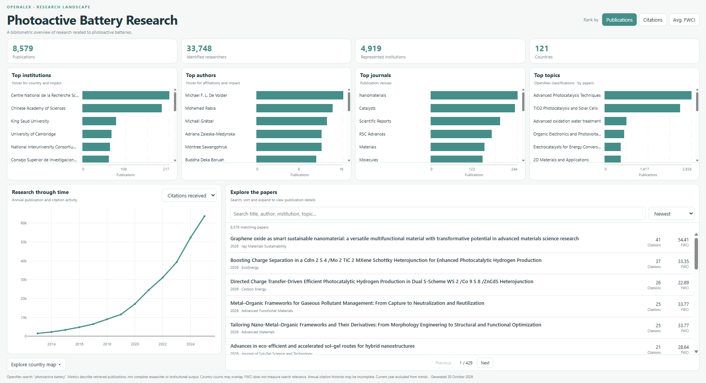
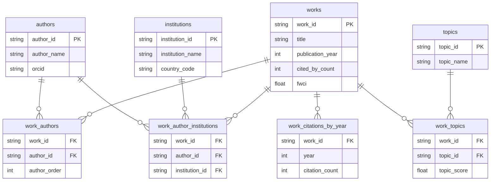

# OpenAlex Research Landscape

### From a nested research API to an interactive dashboard

**A data engineering application example** designed to demonstrate working with a more complex API, transforming nested JSON into a relational database, and using SQL to create analytical datasets.

**Tech stack:** Python · OpenAlex API · DuckDB · SQL · Pandas · Plotly · HTML/CSS/JavaScript

## 1. What I built and who for

This project is designed for researchers and students exploring the research landscape within their field, particularly early-career researchers looking to identify important publications, researchers and institutions.

The dashboard presents publication and citation trends, leading researchers and institutions, journals, research topics and geographical distribution. It also includes a searchable catalogue of publications, allowing users to investigate individual works or explore the research associated with a particular researcher, institution or journal.

I chose *photoactive batteries* as my OpenAlex search term, drawing on my previous research experience, and extracted data covering **8,579 publications**.

The resulting dashboard:



## 2. The data

The [OpenAlex Works API](https://docs.openalex.org/api-entities/works) provides publication metadata including authors, affiliations, citation histories, journals and research topics.

Its nested JSON responses make it particularly useful for demonstrating relational modelling. Individual papers can have multiple authors, affiliations and topics, each requiring relationships to be preserved.

In this pipeline, the extracted data is stored as JSONL, allowing individual pages of results to be appended without rewriting the entire dataset.

## 3. How it works

The pipeline follows four stages:

**Extraction → Relational modelling → Analytical SQL → HTML dashboard**

**Extraction — `api.py`**

Uses cursor-based pagination to retrieve results, with retries, exponential backoff and checkpointing to support interrupted downloads.

**Relational modelling — `build_database.py`**

Transforms nested JSON into eight DuckDB tables, preserving relationships between works, authors, institutions, citation histories and topics.

The database schema is shown below:



*Simplified logical schema showing the main fields and relationships. Not all fields are shown.*

**Analytical SQL — `sql/`**

I started by planning the dashboard structure and content, then worked backwards to identify the datasets and transformations required.

Seven SQL queries produce analytical marts covering publication trends, author and institution rankings, journal and topic summaries, country metrics and an enriched paper catalogue.

These queries use CTEs, joins, aggregations and deduplication to avoid double-counting publications and citations across many-to-many relationships.

I also checked for duplicate identifiers and broken relationships, while investigating missing source metadata to distinguish expected null values from data quality issues.

**Presentation — `report.py`**

Executes the analytical queries against DuckDB and generates a standalone HTML dashboard, with charts, metric selection and expandable publication details.

The analytical logic remains separate from the presentation layer.

## 4. How to run it

Clone the repository:

```bash
git clone https://github.com/hollyxandersen/OpenAlex-DEng-Application-Example-Pipeline.git
cd OpenAlex-DEng-Application-Example-Pipeline
```

Install dependencies:

```bash
pip install -r requirements.txt
```

Create a `.env` file containing your OpenAlex API key:

```text
OPENALEX_API_KEY=your_api_key_here
```

Then run:

```bash
python api.py
python build_database.py
python report.py
```

Open `output/research_landscape.html` in a browser.

Raw data, checkpoint files, database files and credentials are excluded from Git.

## 5. What I'd do next

Potential extensions include:

- **More robust checkpoint recovery:** Improve the extraction process to handle interruptions between writing data and updating the checkpoint, preventing duplicate records when resuming.
- **Automated pipeline tests:** Add tests for API responses, data transformations and referential integrity to catch errors and unexpected changes in the source data.
- **Relevance-based filtering:** The retrieved literature includes research tangential to the selected subfield alongside papers directly focused on photoactive batteries. Consequently, not all researchers and institutions represented are necessarily active in this specific area. Allowing users to filter by OpenAlex's search relevance score could provide a useful second perspective, although this score is not a definitive measure of relevance.
- **Institutional collaboration analysis:** Use the author–institution relationships preserved in the database to explore collaboration networks, identify frequently collaborating institutions and examine international research partnerships.


## 6. Where AI helped

I used ChatGPT as a learning and development tool throughout the project. I wrote and tested the core API extraction and analytical SQL myself, using AI to explain unfamiliar concepts, review code, debug errors and help with repetitive transformations.

I designed the dashboard and specified its functionality, while AI implemented the HTML, CSS and JavaScript.

My aim was to use AI to accelerate development while developing my own understanding of the underlying processes and technical decisions.
